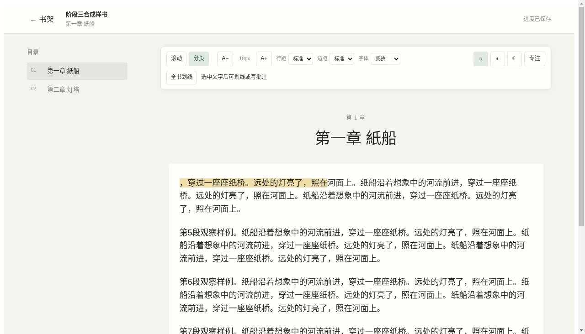
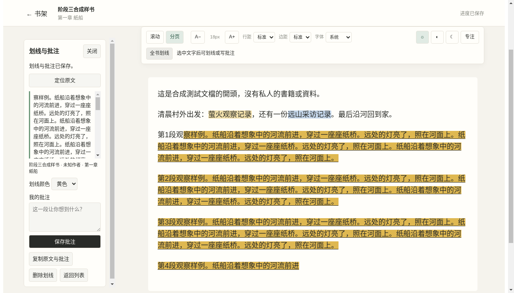
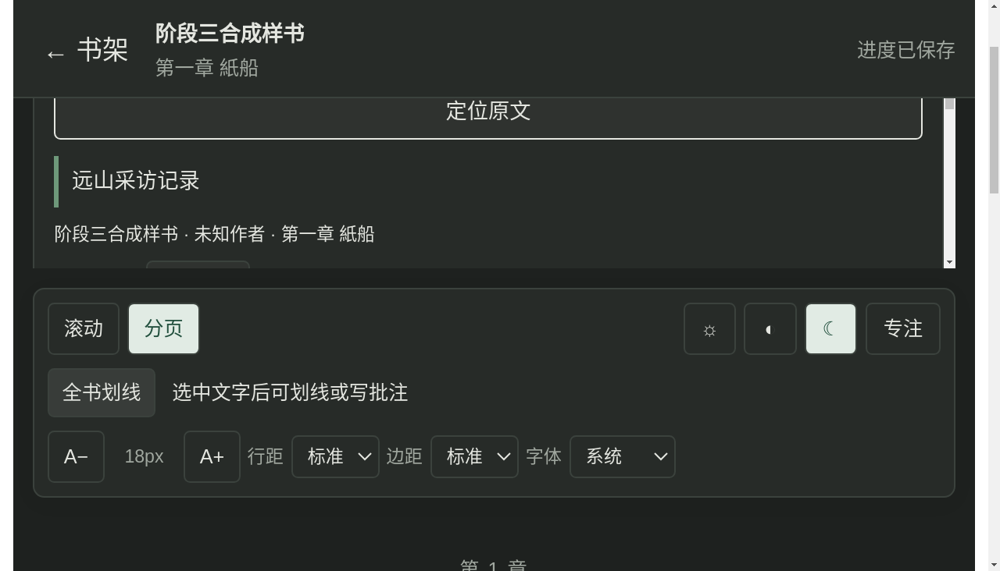
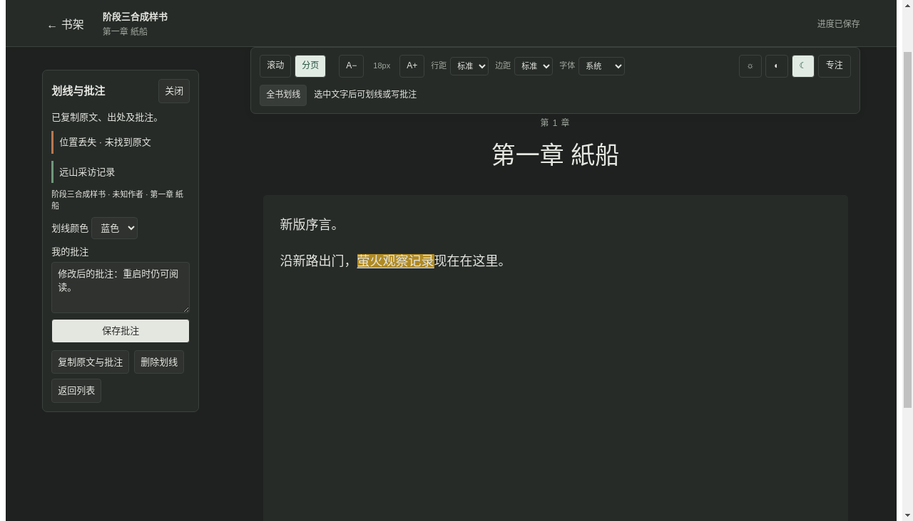
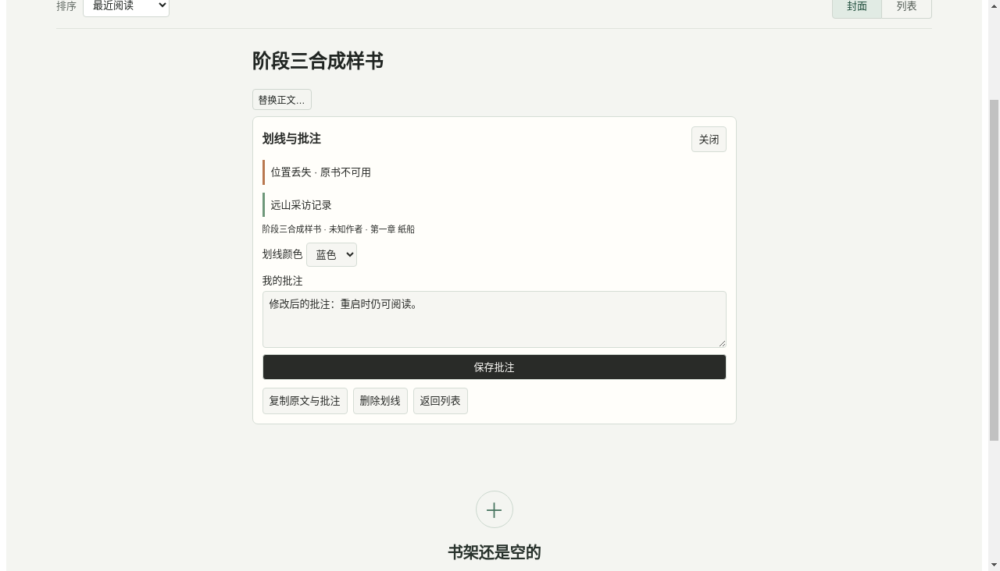
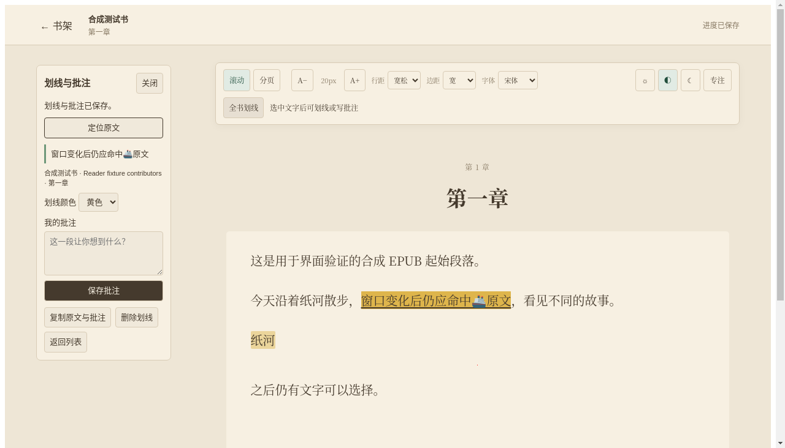
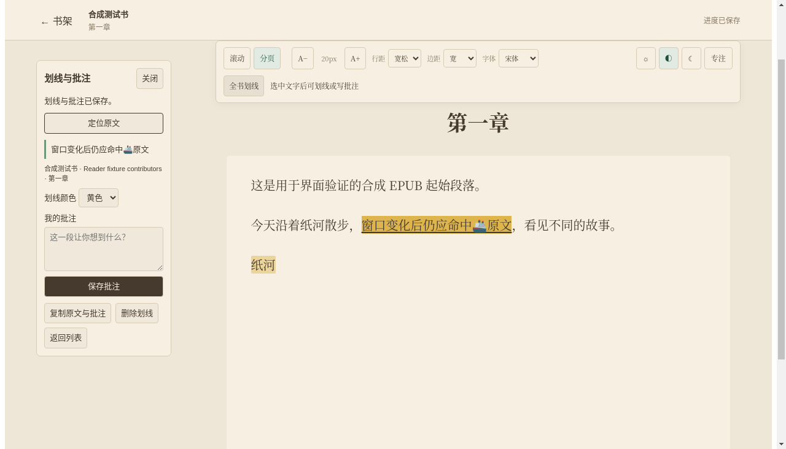

# 阶段 3 GUI 检查截图

- 检查日期：2026-11-20。
- 被测代码：[421f30a](https://github.com/catInWater/isonomia/commit/421f30aaa3e49fa67d1ccb10060c63b12dd7595b)，即本次补交截图之前的功能修订；截图文档提交不改变应用代码。
- 关联：[PR #9](https://github.com/catInWater/isonomia/pull/9)、[阶段 3 规格](../specs/03-anchors-annotations.md)、[ADR-0003](../adr/0003-source-anchors.md)。
- 环境：Linux、生产构建 Electron 34.5.8、私有 headless Wayland 会话、临时用户目录。renderer sandbox 保持启用，进程检查为 `NoNewPrivs: 1`、`Seccomp: 2`。
- 数据：仅使用合成 TXT/EPUB、合成批注和测试夹具；原生文件对话框由测试 harness 提供合成文件响应，不包含私人书籍。
- 下列 9 张 PNG 为实际应用运行时的原始截图，未裁剪或修饰。点击图片可查看原图。静态截图展示界面状态，重启、保存、复制和范围完整性等结论来自交互脚本断言，不以单张截图替代测试。

## 快速检查索引

| 检查内容                                        | 验收关联       | 截图                                                                                            |
| ----------------------------------------------- | -------------- | ----------------------------------------------------------------------------------------------- |
| 两种颜色的划线、批注编辑器和可读出处            | S03-A4         | [01](assets/phase-3/01-highlight-and-note.png)                                                  |
| 同章跨页划线的后半段，以及从批注回跳原文        | S03-A1、S03-A6 | [02](assets/phase-3/02-cross-page-second-page.png)、[03](assets/phase-3/03-cross-page-jump.png) |
| 进程重启后保留的批注、深色主题                  | S03-A4         | [04](assets/phase-3/04-narrow-dark-restarted.png)                                               |
| 替换正文后位置丢失，原文、出处和批注仍保留      | S03-A3         | [05](assets/phase-3/05-replacement-lost-with-note.png)                                          |
| 移除书文件后仍能查看批注                        | S03-A3         | [06](assets/phase-3/06-retained-after-removal.png)                                              |
| EPUB 排版变化后的划线、代理对字符和图片相邻选区 | S03-A1、S03-A2 | [07](assets/phase-3/07-epub-typography-sepia.png)                                               |
| EPUB 窗口调整及分页切换的运行记录               | S03-A2         | [08](assets/phase-3/08-epub-narrow-panel.png)、[09](assets/phase-3/09-epub-narrow-page.png)     |

## 01：划线与批注

正文同时显示黄色和绿色划线；左侧显示选中划线的原文、书名/作者/章节出处、颜色和批注编辑器。交互脚本还验证了修改文字与颜色、双向跳转、列表排序，以及删除后撤销恢复。

## 02：同章跨页选区的后半段

从前一页保存起点、翻页并选取终点后，后一页仍显示该划线的延续部分。脚本断言保存的原文包含完整的 367 个 UTF-16 单元，而不是只保存当前可见页的文字。

## 03：从批注回跳跨页原文

点击“定位原文”后回到选区起始位置；左侧保留跨块原文快照，正文对目标范围短暂强调。02 和 03 是同一条跨页划线的不同可见位置。

## 04：重启后恢复与深色主题

关闭并重新启动真实 Electron 进程后，已保存原文与出处仍可读取，并切换到深色主题。脚本同时检查修改后的批注、颜色和原划线 ID 保持一致。

**抓图限制：**此 PNG 中批注面板仅部分可见；窄视口测试的栅格呈现不能当作完整窄屏视觉验收，详见下方“证据边界”。

## 05：替换正文后位置丢失，但批注保留

受控替换后的正文不再包含原摘录“远山采访记录”。面板明确提示“位置丢失 · 未找到原文”，但原摘录、出处和修改后的批注仍在。复制成功提示来自主进程操作，脚本另行核对了剪贴板中的原文、出处和批注。

同一次交互还断言另一条仍存在的唯一片段可以回退定位；本图展示的是失效分支，不用它替代回退分支的断言。

## 06：移除书文件后保留用户内容

从书架移除书文件并选择保留用户内容后，批注面板显示“位置丢失 · 原书不可用”；原文、出处、颜色和批注仍可查看，并保留复制入口。下方书架为空不代表保留的用户内容被删除。

## 07：EPUB 排版变化与图片相邻选区

合成 EPUB 切换字号、行距、字体、边距及护眼主题后，目标仍为“窗口变化后仍应命中🚢原文”。脚本核对同一划线 ID 和完整原文不变。下方“纸河”的单独划线用于真实 Chromium 元素边界选区检查：没有把相邻图片 run 包含进摘录。

## 08：EPUB 窗口调整后的运行记录

脚本请求 620 × 720 窗口，并断言 `innerWidth <= 640`、页面没有横向溢出、批注面板高度不少于 160 CSS 像素，以及目标划线的原文和 ID 不变。

**抓图限制：**本 PNG 仍呈桌面宽栅格，不能据此认定 620 CSS 像素下的视觉布局正确；它仅保留原始运行记录，窄视口结论限于上述脚本断言。

## 09：EPUB 切换分页后的划线

在同一 EPUB 场景中切换分页、重新打开划线并定位原文。脚本断言原划线 ID、原文和定位强调均正常。本图可检查分页状态及划线内容，但不扩展为完整窄屏视觉验收。

## 证据边界

- 截图是 Linux 生产 Electron 的界面证据，不是浏览器仿制页面，也不是 Windows 实机截图。
- 部分窄视口 PNG 仍呈桌面宽栅格或只显示部分面板；保留原图并明确标注限制，不把 DOM 尺寸断言等同于完整窄屏、高 DPI 或可访问性视觉验收。
- 20 条固定锚点、重复文本歧义、UTF-16 边界、持久化失败、修订冲突和删除撤销等仍以自动测试为依据。被测功能修订有 74 项测试、11 个固定文件校验通过；[对应 CI](https://github.com/catInWater/isonomia/actions/runs/44665883146)的 Linux checks 和 Windows installer 均成功。本次截图文档提交的 CI 状态应以 PR 当前检查为准。
- Windows 安装包构建成功不替代实际安装、启动、卸载和 Windows UI 验收；上述实机验收仍待补充。
- D-07 跨章选区和拖放引用未实现；这里的跨页场景仅在同一章节内。
