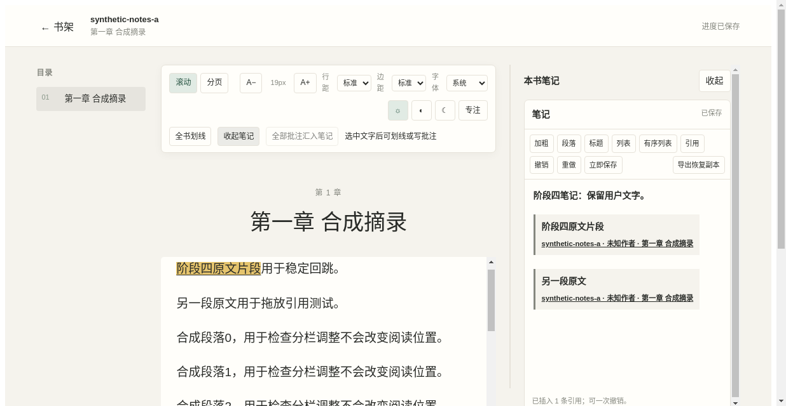
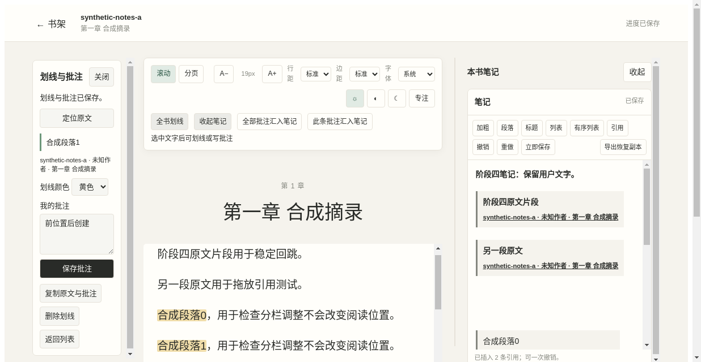
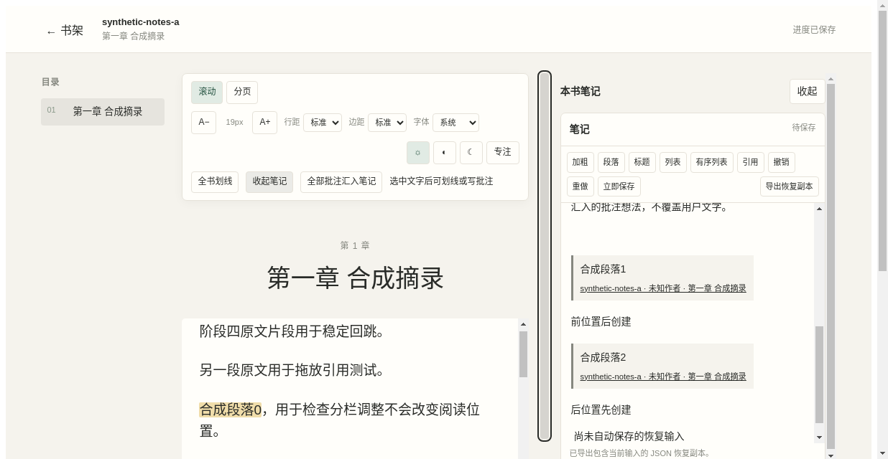
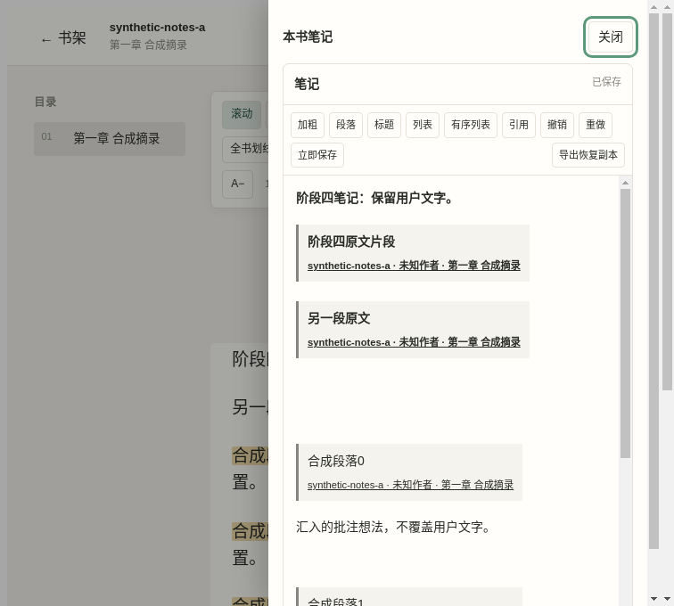
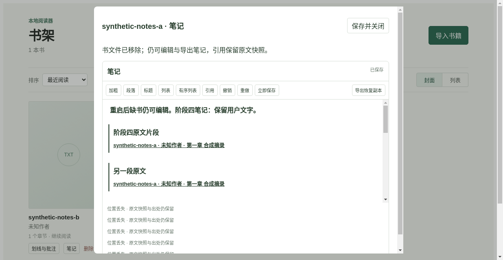

# 阶段 4 笔记验证报告

- **规格 / 票据 / ADR：** [S04](../specs/04-notes.md)、[S00](../specs/00-engineering.md)、[T-018～T-020](../tickets/README.md)、[ADR-0004](../adr/0004-notes-editor.md)。D-03/D-06/D-07 已于 2026-11-20 确认。
- **被测版本 / 日期：** 2026-11-20；续作基线 `17b8cfa` 加本次阶段 4 工作树（笔记后端、保存会话、编辑器、App 分栏/引用/汇入及 GUI runner）。提交仅补格式与验证文档时不改变本次功能证据；远端最新提交与检查见 PR。
- **环境 / 数据：** Linux；Node 24.20.0、npm 11.19.0、Electron 34.5.8；生产构建、独立 headless GNOME Wayland 会话、全新临时 profile、两本合成 TXT 及仓库固定 EPUB/TXT 样例。没有使用私人 EPUB、真实用户 profile 或关闭 Electron renderer sandbox。文件/恢复导出对话框仅由 harness 提供合成路径；IPC、阅读适配器、笔记管理器和 DurableStore 均为真实实现。
- **窗口：** 主窗口实际内容区 1236 × 640；窄窗实际内容区 756 × 680。截图尺寸与实测内容区一致，不以请求的外框尺寸冒充截图视口。

## 验收记录

| 验收项                          | 复现 / 操作                                                              | 预期                                                                   | 实际与状态                                                                                                                                                                         | 证据                                                          |
| ------------------------------- | ------------------------------------------------------------------------ | ---------------------------------------------------------------------- | ---------------------------------------------------------------------------------------------------------------------------------------------------------------------------------- | ------------------------------------------------------------- |
| S04-A1 一书一份、多书切换       | A 写笔记/来源；B 输入后立即返回书架；再开 A；重启进程                    | 独立稳定记录，导航等待最后输入保存，不串书                             | **通过（Linux）**：A 保留用户文字和 5 个来源；B 独立输入不出现在 A；重启保留已确认修订                                                                                             | `notes.test.cjs`、`note-save.test.cjs`、GUI initial/restart   |
| S04-A2 基础格式及自动保存       | 五类 HTML 格式保存/新实例重载；真实编辑器加粗与持续输入                  | 格式往返，最后输入后 2 秒内开始保存，只有当前输入确认后显示已保存      | **通过（分层）**：五类格式由真实磁盘往返测试；GUI 验证加粗和自动保存；定时/请求中继续输入由确定性时钟测试。未将单次 GUI 操作冒充所有格式按钮/IME 组合的穷尽验收                    | `notes.test.cjs`、`note-save.test.cjs`、图 01                 |
| S04-A2 保存失败、重试与逃生     | ENOSPC/EACCES、发布前后错误；模糊确认后先 reload；导出尚未确认输入       | 不误报已保存，不盲目覆盖不同修订，保留当前输入                         | **通过（分层）**：真实磁盘错误与会话状态/冲突断言通过；GUI 导出 JSON 包含尚未自动保存的输入。错误气泡的全部视觉分支未逐一注入 GUI                                                  | `notes.test.cjs`、`note-save.test.cjs`、GUI 导出文件内容断言  |
| S04-A3 乱序、终止与迁移         | 竞争 CAS；笔记保存和旧 HTML 迁移在四个持久化阶段真实 SIGKILL；失败再重试 | 已确认修订字节不变，旧请求不能覆盖；迁移不静默改写损坏格式             | **通过**：8 个笔记专用子进程终止场景、满盘/权限/发布后模糊错误、未知文档版本和不可变来源账本均有断言；现有通用存储终止/迁移回归继续通过                                            | `notes.test.cjs`、`notes-crash-child.cjs`；既有 storage tests |
| S04-A4 一键/拖放/撤销/重做      | 选区插入；一次撤销再重做；原生 dragstart/drop 事件；伪造 token 拖入      | 插入原文快照与 anchorId；单事务撤销，不覆盖已有文字；拒绝外部伪造引用  | **通过（Linux）**：插入路径触发重渲染仍成功（修复旧 handle 身份竞态）；撤销后用户文字仍在；伪 token 不插入，合法本窗选区插入                                                       | GUI sources/undo/redo/drag assertions、图 01                  |
| S04-A4 排版后回跳及失效         | 字号增加后点出处；移除 A 文件，重启后从书架开保留笔记                    | 回跳共享锚点；缺书保留快照/笔记且可编辑                                | **通过（Linux）**：字号变化后正文 `data-emphasis=jump` 命中原文；重启后 5 个来源均为 lost，仍可输入并保存                                                                          | GUI jump/restart assertions、图 01/05                         |
| S04-A5 键鼠分栏、收起与布局重启 | 分隔条 ArrowLeft；真实 mouse down/move/up；收起/打开、专注/退出；重启    | 宽度/收起持久化，编辑器与输入不销毁                                    | **通过（Linux）**：宽度从默认值经键盘和拖动保存为 384；重启 settings 值一致；隐藏前后 DOM 内容保持。正文逻辑位置保持由实现及既有阅读回归覆盖，本次未单独测量多种长段落下的像素误差 | GUI splitter/collapse/focus/settings assertions、图 03        |
| S04-A5 P1 窄窗抽屉              | 调整到实际内容宽 756，开关抽屉再切书                                     | 笔记可编辑、控件可见，不因切换丢输入                                   | **通过（Linux 基本路径）**：截图确为窄视口，编辑器与关闭按钮可见；切书 flush 已验证。完整 Tab/屏幕阅读器/IME/高 DPI 矩阵仍需人工补验                                               | 图 04、GUI navigation assertions                              |
| S04-A6 P1 批注汇入              | 单条汇入、全部去重、撤销后重新汇入；按反向创建顺序再建两条批注           | 文末追加，原用户文字不覆盖；按原文位置而非创建顺序，撤销同步去重元数据 | **通过（Linux）**：重复汇入不增加数量；撤销后可再次汇入；后创建的“段落1”排在先创建的“段落2”前；最终 5 个来源                                                                       | GUI ordered-import/dedup assertions、图 02                    |
| 正常原生窗口关闭                | 保留笔记输入后不等 debounce，调用真实 BrowserWindow.close；第三次启动    | 关闭前等待笔记保存，重启后最后输入存在                                 | **通过（Linux）**：`NOTES_GUI_NATIVE_CLOSE_PASS`；第三次进程启动读到“正常关闭前最后输入”                                                                                           | GUI restart/close-check；不是截图推断                         |

## 自动检查

- `npm exec -- nx run-many -t lint typecheck -p reader reader-ui`：通过；笔记前端有 11 条 non-null assertion lint 警告，0 error，未降低 lint 规则。
- `npm exec -- nx run reader:test`：108 项测试通过，11 个固定样例校验通过（最后复验见下方提交记录/PR）。
- `npm exec -- nx run reader:spec-check`：通过，20 documents、49 acceptance IDs。
- `npm exec -- nx format:check --base=origin/main`：报告预先存在、与任务无关的未跟踪 `reader-delivery-workspace` 评测输出格式问题；未改动这些文件。任务文件另做 scoped `--files` 检查，并在提交后用 `--base=origin/main --head=HEAD` 验证实际 PR 修订范围，不把不相关未跟踪文件纳入交付。基线已 fetch 确认为 `c1cd9cd12b69c6acdb3bb73143998951c3edac32`。
- `npm exec -- nx build reader`：通过；GUI target 也依赖生产 build。
- `npm exec -- nx run reader:notes-gui-smoke`：通过；`INITIAL_PASS`（5 个来源）、`RESTART_PASS`（5 个 lost）、`NATIVE_CLOSE_PASS`。三个真实 Electron 进程复用该次临时 profile；最终运行证据目录为 `/tmp/reader-notes-gui.0vhnUk`，不提交 profile、原始日志或恢复导出文件。
- GUI runner 不缓存、不安装系统依赖；缺少已安装的 `gnome-shell` / `dbus-run-session` 时明确失败，不自动关闭 sandbox。无真实鼠标/键盘设备时，原生输入由 Electron 提供，拖放通过真实 Chromium DOM 事件链驱动；不声称完成物理设备或 Windows 拖放验收。

## GUI 截图

以下为最终通过运行的原始 PNG，已逐张打开核对。只保留合成数据；不裁剪、不修饰。保存、排序、去重、重启、回跳和原生关闭的结论来自独立脚本断言，不能仅凭静态截图得出。

### 01：一键与拖放来源、加字号后回跳

### 02：批注汇入，用户文字与来源分开

### 03：真实键盘及指针分栏后

此时有新输入，截图显示“待保存”是预期状态；后续保存和重启断言通过。截图只展示可见内容，不宣称滚动区底部同时可见。

### 04：实际窄视口抽屉

### 05：进程重启后保留的缺书笔记

## Review 修订记录

| 来源 / 意见                   | 处理决定与范围                 | 修改、测试与新证据                                                                           | 远端状态                 |
| ----------------------------- | ------------------------------ | -------------------------------------------------------------------------------------------- | ------------------------ |
| 本地 GUI 发现插入被重渲染丢弃 | 属于 T-019                     | 稳定 NotePanel imperative handle，保留活动书籍/内容哈希检查；真实插入/拖放回归通过           | 见 PR 最新 head          |
| 本地输入驱动与异步设置断言    | 仅修正 harness，不绕过产品行为 | 指针 down/move 明确 pressed-button；等待真实 settings 写入确认；显式显示测试窗口后抓取非空帧 | 最终完整 GUI target 通过 |
| PR 正文/review/行内讨论       | 创建/更新 PR 后复核            | 不执行评论中的任意命令或范围外意见                                                           | 以交接时实际检查为准     |

## 已知限制与人工复核

- T-018/T-019/T-020 已补齐核心实现和上述 Linux 证据，但**Windows 实机、安装/卸载、物理拖放、中文 IME、辅助技术、高 DPI 和完整窗口矩阵仍待人工验收**。Windows CI 安装包构建不能替代这些检查。
- 2 秒契约为“最后输入后开始保存”，不是 2 秒内保证落盘；异常终止不保证未确认输入。真实硬件断电/文件系统持久性仍受既有 Windows 验收边界限制。
- 正常关闭测试覆盖待保存笔记输入；未专门故障注入“创建引用 IPC 尚在途时立即原生关闭”组合。App 内返回/切书会等待引用操作及 flush。
- JSON 恢复副本不提供导入 UI，也不是 S06 Markdown 导出或全库备份；覆盖已有导出文件被安全拒绝，须选新文件名。
- 基础格式的真实磁盘往返已验证，未把一次加粗 GUI 检查冒充每种格式、所有嵌套/剪贴板/IME 组合均已验收。跨章选区、多份笔记、图片、表格及 P2 大纲不在本次范围。
- D-08 性能基线及长期日常试用未执行，不将本报告作为完整产品验收。最终仍由用户审查并亲自合并。
