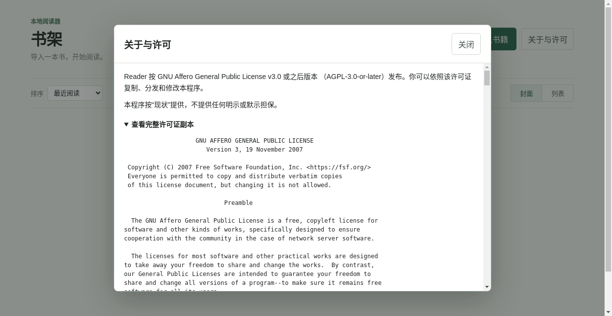

# Reader 1.0.0 发布与许可证验证报告

- **规格 / 票据 / ADR：** 发布范围为 1.0.0 Windows x64 NSIS 安装包、仓库许可证元数据、应用内法律告知与 README；无新增产品规格。
- **被测版本 / 日期：** `origin/main` `3d3c902fd26e4f5d1ab6c980795541cce9be45d8` + release worktree 未提交改动；2026-11-22。
- **环境 / 数据：** Linux x86_64、Node 24.20.0、Electron 34.5.8、Nx 22、production build；GUI 使用 synthetic EPUB/TXT、独立临时 profile、headless GNOME Wayland compositor，视口 1236×640，Electron sandbox 保持启用。未读取真实书籍或用户 profile。

## 验收记录

| 验收项                   | 复现 / 操作                                                                    | 预期                                                                                                                            | 实际与状态                                                                             | 证据                                                                                          |
| ------------------------ | ------------------------------------------------------------------------------ | ------------------------------------------------------------------------------------------------------------------------------- | -------------------------------------------------------------------------------------- | --------------------------------------------------------------------------------------------- |
| AGPL 仓库授权            | 检查 `LICENSE`、根 `package.json`、两个 app manifest 和 lockfile               | 项目元数据统一为 AGPL-3.0-or-later，LICENSE 为完整规范文本                                                                      | **通过**；测试断言全部元数据，`LICENSE` 与 renderer 资源字节一致                       | `npm exec -- nx run reader:test`；`tests/release/license.test.cjs`                            |
| 应用内法律告知           | 在书架点击“关于与许可”，展开完整许可证副本                                     | 可见 AGPL 标识、复制/分发/修改许可说明、无担保声明，并能查看完整许可证                                                          | **通过**；真实 production Electron GUI 断言文本和完整 AGPL v3 文本可见；截图已打开核对 | [应用内许可证告知](assets/release-1.0.0/license-notice.png)                                   |
| renderer 许可证资源      | 运行 production build，检查 `dist/apps/reader-ui/assets/AGPL-3.0-or-later.txt` | 打包 renderer 包含完整许可证                                                                                                    | **通过**；构建产物与根 `LICENSE` SHA-256 相同                                          | `npm exec -- nx build reader`；`cmp LICENSE dist/apps/reader-ui/assets/AGPL-3.0-or-later.txt` |
| Windows release workflow | 检查 `.github/workflows/release.yml`                                           | 版本 tag 与根 manifest 一致后，在 Windows 上运行检查、构建 unsigned x64 NSIS、校验许可证、生成 SHA256SUMS 并发布 GitHub Release | **已实现，未在本地 Windows 执行**；Linux 不能替代 Windows installer / 实机验收         | `.github/workflows/release.yml`                                                               |

## 自动检查

- `npm ci`：通过；安装时报告依赖树现有审计结果：67 vulnerabilities（39 moderate、26 high、2 critical），未执行会改变依赖的 `npm audit fix`。
- `npm exec -- nx run-many -t lint typecheck -p reader reader-ui`：通过，0 errors；保留 10 项既有 non-null assertion warnings。
- `npm exec -- nx run reader:test`：通过，112/112 tests；11 个 fixture 校验通过。
- `npm exec -- nx run reader:spec-check`：通过，21 份文档、52 个验收 ID。
- `npm exec -- nx build reader`：通过；production renderer 和 Electron shell 构建成功，许可证资源存在于 renderer 输出。
- `npm exec -- nx run reader:notes-gui-smoke`：通过；真实 sandbox Electron 三阶段（initial/restart/close-check）完成，包含许可证告知、完整文本展开、笔记回归和重启/正常关闭检查。运行日志有环境 `No space left on device` inotify warnings，但测试最终通过。
- `npm exec -- nx format:check --base=origin/main` 与 `git diff --check`：通过。

## GUI 截图

截图来自最终通过的 `/tmp/reader-notes-gui.Dx4Mjj`，只含 synthetic EPUB/TXT 与临时 profile；复制入仓库后已逐张打开核对。

## 发布限制与人工复核

- Windows x64 NSIS 安装包尚未在本地 Windows 实机安装、启动、升级或卸载；GitHub Actions Windows job 才是 release asset 的构建环境。
- 安装包当前未签名，Windows 可能显示发布者或 SmartScreen 警告；发布 workflow 会生成 `SHA256SUMS.txt`，但用户仍应从可信 release 下载并核对校验值。
- GitHub tag、release 和 Windows asset 需在本候选合并到 `main` 后由远端 workflow 创建；本地 Linux build 不能宣称已经发布。
- 依赖审计结果保留为报告，不在本次许可证/发布范围内升级依赖。
